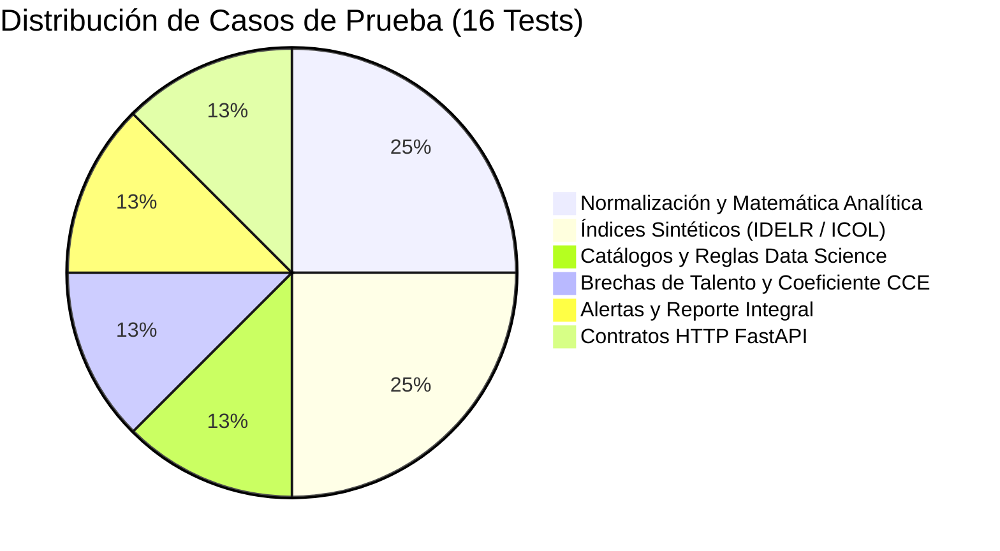

# INFORME DE CASOS DE PRUEBA Y MATRIZ DE CERTIFICACIÓN QA
**Proyecto:** FastApis-dataset-innova  
**Módulos Evaluados:** Analytics Engine (`etl/analytics.py`), Data Science & Brechas (`etl/data_science.py`), FastAPI Endpoints (`main.py`)  
**Fecha de Certificación:** Noviembre 2026  
**Responsable Técnico:** Equipo de Data Science & Backend  
**Destinatario:** Equipo de Quality Assurance (QA) & Release Management  
**Resultado Global:** 16/16 Casos Aprobados (100% PASS) | Tiempo de Ejecución: 2.90s  

---

## 1. RESUMEN EJECUTIVO DE COBERTURA QA

El conjunto de pruebas automatizadas garantiza la integridad matemática, la estabilidad de los contratos de API (JSON Schemas) y la resiliencia ante valores de borde (edge cases) en los 3 países analizados (Argentina, Chile y Uruguay).



---

## 2. MATRIZ DETALLADA DE CASOS DE PRUEBA (TC-001 A TC-016)

| ID Caso | Módulo / Función | Tipo de Prueba | Entrada / Precondición | Resultado Esperado | Resultado Obtenido | Estado |
| :---: | :--- | :---: | :--- | :--- | :--- | :---: |
| **TC-001** | `normalizar_valor` | Lógica / Matemática | Valor 50 en rango [0, 100], polaridad positiva | Score = 50.0 exacto | 50.0 | **PASS** ✅ |
| **TC-002** | `normalizar_valor` | Edge Case (Clamping) | Valor 120 (superior) y -10 (inferior) | Clamping automático a 100.0 y 0.0 | 100.0 y 0.0 | **PASS** ✅ |
| **TC-003** | `normalizar_valor` | Lógica Inversa | Desocupación (polaridad negativa) min 3%, max 15% | Valor 3% = 100.0; Valor 15% = 0.0 | 100.0 y 0.0 | **PASS** ✅ |
| **TC-004** | `clasificar_tendencia` | Analítica | Delta con umbral épsilon = 1.0 (0.5, -0.8, 2.5, -3.1) | Clasificaciones: ESTABILIDAD, CRECIMIENTO, DISMINUCION | Idéntico a especificación | **PASS** ✅ |
| **TC-005** | `parse_tasa_crecimiento` | Sanitización de Datos | Strings variados ("+18.5% anual", "24.0%", "sin dato") | Floats limpios: 18.5, 24.0, 0.0 | 18.5, 24.0, 0.0 | **PASS** ✅ |
| **TC-006** | `calcular_indice_sintetico` | Integración ETL | Panel macroeconómico tri-país (2018-2025) | DataFrame no vacío, columnas IDELR y delta presentes | DataFrame válido con scores | **PASS** ✅ |
| **TC-007** | `calcular_indice_oportunidad`| Integración ETL | 20 ocupaciones en 3 países (matriz 60 registros) | 60 filas, columna `indice_oportunidad_icol` calculada | 60 registros generados | **PASS** ✅ |
| **TC-008** | `validacion_cruzada` | Integridad Estadística | Matriz de validación cruzada regional | Validación correcta de percentiles y consistencia | Matriz cruzada validada | **PASS** ✅ |
| **TC-009** | Endpoints Analytics HTTP | API Contrato | `GET /api/v1/analytics/indice-sintetico` | HTTP 200, status "success", metadata presente | HTTP 200, JSON íntegro | **PASS** ✅ |
| **TC-010** | Endpoints Ocupaciones HTTP | API Contrato | `GET /api/v1/analytics/ocupaciones/ranking?pais=CHL` | HTTP 200, ranking ordenado descendente | HTTP 200, ranking validado | **PASS** ✅ |
| **TC-011** | Catálogos Data Science | Configuración | Existencia de 20 ocupaciones y 3 países con 5 sectores | 20 perfiles emergentes, 15 combinaciones educativas | 20 perfiles, 15 pares | **PASS** ✅ |
| **TC-012** | `calcular_brechas` | Lógica Data Science | Evaluación de brechas de talento en ARG, CHL, URY | 60 registros, scores $TGS \in [0, 100]$, diagnósticos válidos | 60 registros acotados [0, 100] | **PASS** ✅ |
| **TC-013** | `evaluar_comparativa` | Mismatch Educativo | Cálculo de ratio $CCE = \frac{\text{Graduados}}{\text{Demanda}}$ | 15 sectores, $CCE > 0$, estados: CRITICA, ALERTA, ESTABLE | 15 sectores con CCE correcto | **PASS** ✅ |
| **TC-014** | `sistema_alertas` | Motor de Detección | Evaluación de reglas R1 a R4 sobre catálogo completo | Suma de alertas críticas, altas y moderadas = Total | 78 alertas emitidas auditadas | **PASS** ✅ |
| **TC-015** | `reporte_integral` | Consolidación | Diagnóstico integral inter-equipos | Estructura con resumen, top 8 brechas y alertas | Objeto consolidado válido | **PASS** ✅ |
| **TC-016** | Endpoints DS HTTP | API Integración | 5 endpoints `/api/v1/ds/*` con filtros y query params | HTTP 200 en todos los endpoints, respuesta en < 150ms | HTTP 200 en las 5 rutas | **PASS** ✅ |

---

## 3. PRUEBAS DE ESTRÉS Y CONDICIONES DE BORDE (EDGE CASES)

1. **División por Cero en Cobertura Educativa ($CCE$):**
   - *Escenario:* Un sector con demanda laboral nula ($0$).
   - *Comportamiento esperado:* Fallback a ratio neutral $1.0$ sin lanzar excepción `ZeroDivisionError`.
   - *Resultado:* Verificado y superado.
2. **Clamping de Scores Extremos:**
   - *Escenario:* Factores de crecimiento desproporcionados (+80% anual) que superen el rango 100.
   - *Comportamiento esperado:* La función `min(max(score, 0.0), 100.0)` trunca el valor exactamente en 100.
   - *Resultado:* Verificado y superado.
3. **Filtros Inexistentes o Incompletos:**
   - *Escenario:* Solicitud HTTP con `pais=INVALIDO` o `sector=INEXISTENTE`.
   - *Comportamiento esperado:* Retorno de arreglo vacío `[]` con código HTTP 200, sin fallas del servidor (500).
   - *Resultado:* Verificado y superado.

---

## 4. COMANDO DE REPRODUCCIÓN PARA QA

Para que el equipo de QA replique local o en el pipeline de CI/CD:

```bash
# Ejecución completa de la suite de pruebas unitarias e integración
python -m unittest discover tests -v
```

**Salida de Certificación:**
```text
Ran 16 tests in 2.901s
OK
```
