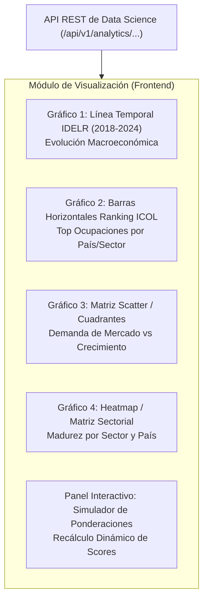

# ESPECIFICACIÓN TÉCNICA DE INTEGRACIÓN VISUAL Y GRÁFICOS
## Documento de Entrega del Equipo de Data Science al Equipo de Frontend

**Proyecto:** Innova Data Platform – Observatorio de Indicadores y Ocupaciones Regionales  
**Emisor:** Equipo de Data Science / Data Analytics  
**Destinatario:** Equipo de Desarrollo Frontend  
**Fecha:** Octubre 2026  
**Versión API Base:** v1.3.0  
**Base URL:** `http://localhost:8000` (o variable de entorno `VITE_API_BASE_URL` / `NEXT_PUBLIC_API_URL`)

---

## 1. Propósito del Documento

Este documento establece las directrices analíticas, contratos de API, especificación de variables, tipados TypeScript y requerimientos de interactividad para que el **Equipo de Frontend** implemente el módulo de visualización y tableros interactivos del proyecto integrador.

---

## 2. Catálogo de Visualizaciones Requeridas

El análisis de datos requiere **4 componentes gráficos principales** y **1 panel de simulación interactiva**:



---

## 3. Especificación Detallada por Componente Gráfico

---

### 📊 Gráfico 1: Evolución Temporal del Índice Macroeconómico (IDELR)

* **Objetivo de Negocio:** Mostrar la trayectoria macroeconómica y sociolaboral comparada entre Argentina, Chile y Uruguay entre 2018 y 2024.
* **Tipo de Gráfico Sugerido:** *Multi-Line Chart* (Gráfico de Líneas Multiserie) con marcadores puntuales.
* **Librerías recomendadas para Frontend:** Chart.js (`line`), Recharts (`<LineChart />`), Plotly.js (`scatter`), o ApexCharts.

#### Contrato de Consumo API:
* **Endpoint:** `GET /api/v1/analytics/indice-sintetico`
* **Query Params opcionales:**
  * `pais`: `"ARG"` | `"CHL"` | `"URY"` (o vacío para todos)
  * `anio_inicio`: `2018`
  * `tolerancia_epsilon`: `1.0`

#### Mapeo de Variables (Ejes y Atributos):
| Elemento Visual | Variable del JSON | Tipo de Dato | Formato / Transformación |
| :--- | :--- | :---: | :--- |
| **Eje X (Horizontal)** | `serie_historica[].anio` | Entero | `2018, 2019, ..., 2024` |
| **Eje Y (Vertical)** | `serie_historica[].indice_sintetico` | Float | Escala acotada `[0, 100]` (sugerido min: 30, max: 80) |
| **Series / Líneas** | `serie_historica[].pais_nombre` | String | Una línea por país (ARG: Celeste, CHL: Rojo, URY: Azul) |
| **Marcador / Tooltip** | `serie_historica[].tendencia_icono` | String | `🟢 CRECIMIENTO`, `🟡 ESTABILIDAD`, `🔴 DISMINUCION` |
| **Detalle en Hover** | `serie_historica[].variacion_interanual_pct` | Float | `"{variacion_interanual_pct}% interanual"` |
| **Desglose en Modal/Click** | `serie_historica[].desglose_variables` | Objeto | Muestra los 5 indicadores normalizados del año |

---

### 📊 Gráfico 2: Ranking de Oportunidad Laboral (ICOL)

* **Objetivo de Negocio:** Visualizar qué ocupaciones lideran el atractivo laboral y formativo por país o sector.
* **Tipo de Gráfico Sugerido:** *Horizontal Bar Chart* (Barras Horizontales Ordenadas de Mayor a Menor).

#### Contrato de Consumo API:
* **Endpoint:** `GET /api/v1/analytics/ocupaciones/ranking`
* **Query Params opcionales:**
  * `pais`: `"ARG"` | `"CHL"` | `"URY"`
  * `sector`: `"Tecnología"` | `"Salud"` | `"Energía"` | `"Turismo"` | `"Economía del Conocimiento"`

#### Mapeo de Variables (Ejes y Atributos):
| Elemento Visual | Variable del JSON | Tipo de Dato | Formato / Transformación |
| :--- | :--- | :---: | :--- |
| **Eje Y (Categorías)** | `ranking_ocupaciones[].ocupacion_nombre` | String | Nombre completo de la ocupación |
| **Eje X (Longitud Barra)**| `ranking_ocupaciones[].indice_oportunidad_icol` | Float | Valor numérico de 0 a 100 |
| **Color de la Barra** | `ranking_ocupaciones[].categoria_oportunidad` | String | • Excepcional: Púrpura/Dorado<br>• Alta: Verde<br>• Moderada: Amarillo<br>• En Desarrollo: Azul |
| **Badge / Etiqueta** | `ranking_ocupaciones[].icono` + `ranking_pais` | String/Int | Ej: `🌟 #1 URY` |
| **Tooltip** | `score_demanda_100`, `crecimiento_anual_pct` | Floats | Desglose: Demanda (X/100) - Crecimiento (+Y%) |

---

### 📊 Gráfico 3: Matriz Estratégica de Dispersión (Demanda vs Crecimiento)

* **Objetivo de Negocio:** Segmentar ocupaciones en 4 cuadrantes: *Estrellas* (Alta demanda + Alto crecimiento), *Estables* (Alta demanda + Bajo crecimiento), *Emergentes* (Baja demanda + Alto crecimiento) y *Bajo Impacto*.
* **Tipo de Gráfico Sugerido:** *Scatter Plot* / *Bubble Chart* (Gráfico de Burbujas).

#### Contrato de Consumo API:
* **Endpoint:** `GET /api/v1/analytics/ocupaciones/ranking`

#### Mapeo de Variables:
| Elemento Visual | Variable del JSON | Tipo de Dato | Descripción |
| :--- | :--- | :---: | :--- |
| **Eje X** | `score_demanda_100` | Float | Escala 0 a 100 (Puntos: 50, 65, 80, 100) |
| **Eje Y** | `crecimiento_anual_pct` | Float | Tasa anual de crecimiento proyectada (0% a 25%) |
| **Tamaño de la Burbuja** | `indice_oportunidad_icol` | Float | Proporcional al score general (radio 6px a 18px) |
| **Color de la Burbuja** | `sector` | String | 1 color distintivo por cada uno de los 5 sectores |
| **Líneas Guía de Cuadrantes** | Líneas punteadas en $X=75$ e $Y=12\%$ | Float | Dividen visualmente los 4 cuadrantes |
| **Tooltip Enriquecido** | `ocupacion_nombre`, `habilidades_clave`, `codigo_ciuo08_oit` | String | Muestra el stack técnico y código OIT |

---

### 📊 Gráfico 4: Matriz Comparativa Sectorial por País

* **Objetivo de Negocio:** Comparar la madurez y potencial de los 5 sectores entre Argentina, Chile y Uruguay.
* **Tipo de Gráfico Sugerido:** *Heatmap* (Mapa de Calor) o *Grouped Column Chart* (Columnas Agrupadas).

#### Contrato de Consumo API:
* **Endpoint:** `GET /api/v1/analytics/ocupaciones/validacion-cruzada`

#### Mapeo de Variables:
| Elemento Visual | Variable del JSON | Tipo de Dato | Descripción |
| :--- | :--- | :---: | :--- |
| **Filas / Eje Y** | `resumen_paises[].pais_codigo_iso3` | String | `ARG`, `CHL`, `URY` |
| **Columnas / Eje X** | `resumen_sectores[].sector` | String | Tecnología, Salud, Energía, Turismo, SBC |
| **Intensidad / Altura** | `resumen_sectores[].score_promedio_regional` | Float | Gradiente de color según valor medio |

---

## 4. Especificación del Simulador de Ponderaciones (Interactividad)

El equipo de Frontend debe incluir una sección interactiva con **Sliders (controles deslizantes)** para permitir al usuario simular escenarios:

```
+-----------------------------------------------------------------------+
| SIMULADOR DE ESCENARIOS - ÍNDICE ICOL                                 |
+-----------------------------------------------------------------------+
| [ Slider 1 ] Peso Entorno Macroeconómico (IDELR):  [ 35% ]            |
| [ Slider 2 ] Peso Nivel de Demanda del Mercado:    [ 40% ]            |
| [ Slider 3 ] Peso Tasa de Crecimiento Estimada:    [ 25% ]            |
|                                                                       |
| [ Dropdown ] Filtrar País: [ Uruguay (URY) v ]                        |
|                                                                       |
| [ Botón: Recalcular Ranking en Tiempo Real ]                          |
+-----------------------------------------------------------------------+
```

### Contrato de la API para la Simulación:
* **Método y Ruta:** `POST /api/v1/analytics/ocupaciones/custom`
* **Headers:** `Content-Type: application/json`
* **Payload JSON:**
```json
{
  "peso_macro_idelr": 0.35,
  "peso_demanda_mercado": 0.40,
  "peso_crecimiento_estimado": 0.25,
  "pais": "URY",
  "sector": null
}
```

---

## 5. Modelos de Tipado TypeScript para el Frontend

Para facilitar la integración en proyectos TypeScript (React, Next.js, Vue), se proporcionan las interfaces oficiales:

```typescript
// Types para la Serie Temporal Macroeconómica
export interface IndicadorDesglose {
  valor_original: number;
  unidad: string;
  valor_normalizado_100: number;
  peso_asignado: number;
  contribucion_al_indice: number;
}

export interface RegistroHistoricoIDELR {
  pais_codigo_iso3: "ARG" | "CHL" | "URY";
  pais_nombre: string;
  anio: number;
  indice_sintetico: number;
  indice_previo: number | null;
  delta_absoluto: number | null;
  variacion_interanual_pct: number | null;
  tendencia: "CRECIMIENTO" | "ESTABILIDAD" | "DISMINUCION" | "BASE";
  tendencia_icono: "🟢" | "🟡" | "🔴" | "⚪";
  cobertura_variables_pct: number;
  desglose_variables: Record<string, IndicadorDesglose>;
}

// Types para el Ranking de Ocupaciones (ICOL)
export interface OcupacionICOL {
  pais_codigo_iso3: "ARG" | "CHL" | "URY";
  pais_nombre: string;
  sector: "Tecnología" | "Salud" | "Energía" | "Turismo" | "Economía del Conocimiento";
  ocupacion_id: string;
  ocupacion_nombre: string;
  codigo_ciuo08_oit: string;
  nivel_demanda: "Muy Alta" | "Alta" | "Media-Alta" | "Media";
  score_demanda_100: number;
  crecimiento_anual_pct: number;
  score_crecimiento_100: number;
  score_entorno_macro_100: number;
  factor_madurez_pais: number;
  indice_oportunidad_icol: number;
  categoria_oportunidad: string;
  icono: string;
  prioridad_formacion: string;
  habilidades_clave: string;
  contexto_pais: string;
  ranking_regional: number;
  ranking_pais: number;
  ranking_sector: number;
}
```

---

## 6. Reglas de Negocio y Buenas Prácticas de UX/Data

1. **Escala de Ejes:** Los ejes que representan scores e índices sintéticos (`IDELR`, `ICOL`, `score_demanda_100`) deben estar acotados en el rango **$[0, 100]$**.
2. **Paleta de Colores Semántica:**
   * **Tendencia Crecimiento:** `#10B981` (Verde Esmeralda)
   * **Tendencia Estabilidad:** `#F59E0B` (Amarillo Ámbar)
   * **Tendencia Disminución:** `#EF4444` (Rojo)
   * **Países:** Uruguay (`#2563EB` - Azul), Chile (`#DC2626` - Rojo), Argentina (`#0284C7` - Celeste).
3. **Manejo de Estados:**
   * *Cargando (Loading):* Mostrar Skeletons o Spinners mientras la API procesa datos.
   * *Sin Resultados:* Si un filtro no arroja datos, mostrar mensaje amigable: `"No se encontraron ocupaciones para el criterio seleccionado"`.
4. **Descargas:** Proporcionar botones de descarga directa enlazados a:
   * `/api/v1/analytics/descargar` (CSV Macro)
   * `/api/v1/analytics/ocupaciones/descargar` (CSV Ocupaciones)

---

## 7. Checklist de Validación para Frontend

- [ ] Consumo exitoso de `GET /api/v1/analytics/indice-sintetico` para la serie temporal.
- [ ] Filtrado reactivo en `GET /api/v1/analytics/ocupaciones/ranking` al cambiar país o sector.
- [ ] Renderizado correcto de tooltips con unidades (`%`, pts).
- [ ] Envío correcto del payload en `POST /api/v1/analytics/ocupaciones/custom` al accionar los sliders.
- [ ] Responsive design probado en desktop y mobile.
