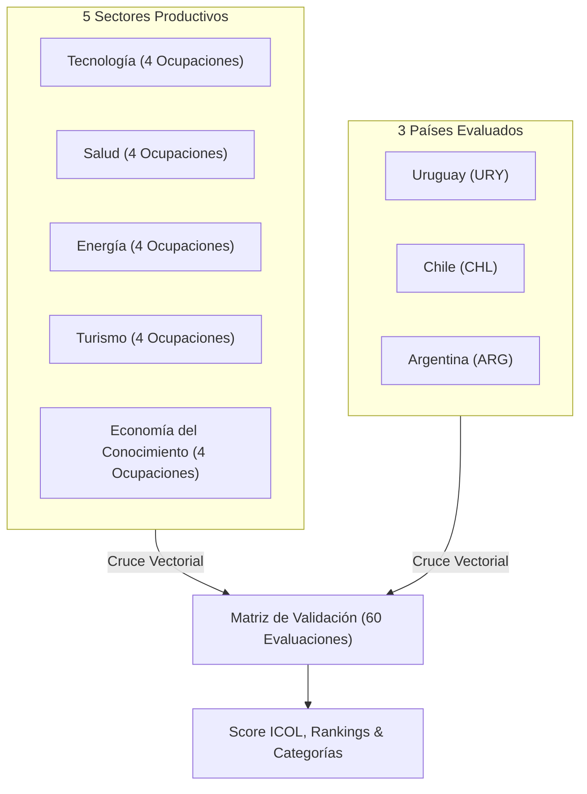

# INFORME TÉCNICO METODOLÓGICO: ÍNDICES SINTÉTICOS Y MODELADO DE OCUPABILIDAD REGIONAL
## Cono Sur: Argentina (ARG), Chile (CHL) y Uruguay (URY)

**Proyecto:** Innova Data Platform – Observatorio de Indicadores y Ocupaciones Regionales  
**Equipo de Datos & Analítica:** Data Team  
**Fecha:** Octubre 2026  
**Versión de la API:** v1.3.0  
**Estándares y Fuentes:** CIUO-08 (OIT), CEPALSTAT, INDEC (ARG), INE (CHL), INE (URY).

---

## 1. Resumen Ejecutivo

El presente informe detalla la formulación matemática, el sistema de ponderaciones multidimensionales y la matriz de validación empírica de los dos índices sintéticos desarrollados en la plataforma:

1. **IDELR (Índice de Desarrollo Económico-Laboral Regional):** Evalúa la evolución macroeconómica y socio-laboral interanual de los países del Cono Sur en series de panel (2018–2024).
2. **ICOL (Índice Compuesto de Oportunidad Laboral):** Evalúa el atractivo y viabilidad estratégica de **20 ocupaciones clave** distribuidas en **5 sectores productivos** para **Argentina, Chile y Uruguay** (60 combinaciones).

---

## 2. Metodología y Formulación Matemática

### 2.1. Normalización Min-Max Acotada

Para unificar variables continuas expresadas en diferentes unidades (`%`, `Índice base 2018=100`, `% del PIB`), se aplica normalización lineal estandarizada en la escala $[0, 100]$:

* **Para variables de Polaridad Positiva** (Crecimiento del PIB, Salario Real, Tasa de Empleo, Tasa de Graduación Secundaria):
  $$X_{i, p, t}^{\text{norm}} = \text{clamp}\left( \frac{X_{i, p, t} - \min_i}{\max_i - \min_i} \times 100, \, 0, \, 100 \right)$$

* **Para variables de Polaridad Negativa / Inversa** (Tasa de Desocupación Total):
  $$X_{i, p, t}^{\text{norm}} = \text{clamp}\left( \frac{\max_i - X_{i, p, t}}{\max_i - \min_i} \times 100, \, 0, \, 100 \right)$$

---

### 2.2. Cálculo del IDELR (Nivel Macroeconómico País)

El índice sintético anual para el país $p$ en el año $t$ se obtiene como una combinación lineal ponderada:

$$IDELR_{p, t} = \frac{\sum_{i=1}^{n} w_i \cdot X_{i, p, t}^{\text{norm}}}{\sum_{i=1}^{n} w_i \cdot \mathbb{I}(X_{i, p, t} \text{ está presente})}$$

#### Matriz de Ponderaciones por Defecto (IDELR):
| Dimensión | Indicador | Peso ($w_i$) | Polaridad | Rango Teórico $[\min, \max]$ |
| :--- | :--- | :---: | :---: | :---: |
| **Economía** | Variación Anual del PIB Real | `0.25` (25%) | Positiva | `[-12.0%, +15.0%]` |
| **Salarios** | Índice de Salario Real | `0.25` (25%) | Positiva | `[60.0, 120.0]` |
| **Empleo** | Tasa de Ocupación | `0.20` (20%) | Positiva | `[30.0%, 65.0%]` |
| **Educación** | Tasa de Finalización Secundaria | `0.15` (15%) | Positiva | `[40.0%, 90.0%]` |
| **Empleo** | Tasa de Desocupación Total | `0.15` (15%) | Negativa | `[3.0%, 15.0%]` |

#### Dinámica Temporal y Clasificación con Banda Muerta ($\epsilon = 1.0\%$):
$$\Delta\%_{p, t} = \frac{IDELR_{p, t} - IDELR_{p, t-1}}{IDELR_{p, t-1}} \times 100$$

$$\text{Tendencia}_{p, t} = \begin{cases} 
\text{CRECIMIENTO } (\text{🟢}) & \text{si } \Delta\%_{p, t} > 1.0\% \\
\text{ESTABILIDAD } (\text{🟡}) & \text{si } -1.0\% \le \Delta\%_{p, t} \le 1.0\% \\
\text{DISMINUCIÓN } (\text{🔴}) & \text{si } \Delta\%_{p, t} < -1.0\% \\
\text{BASE } (\text{⚪}) & \text{para el año inicial de la serie}
\end{cases}$$

---

### 2.3. Cálculo del ICOL (Nivel Ocupación x Sector x País)

El Índice Compuesto de Oportunidad Laboral integra la salud del entorno macro con la demanda sectorial y la tasa de expansión de cada ocupación:

$$ICOL_{o, p} = \text{clamp}\left( \left[ w_{\text{macro}} \cdot IDELR_p^{\text{actual}} + w_{\text{demanda}} \cdot S_d(o) + w_{\text{crec}} \cdot S_c(o) \right] \times F_m(p), \, 0, \, 100 \right)$$

* **Ponderaciones:** $w_{\text{macro}} = 0.35$, $w_{\text{demanda}} = 0.40$, $w_{\text{crec}} = 0.25$.
* **Cuantificación de Demanda ($S_d$):**
  * `Muy Alta`: $100.0$ pts
  * `Alta`: $80.0$ pts
  * `Media-Alta`: $65.0$ pts
  * `Media`: $50.0$ pts
* **Factor de Madurez Contextual ($F_m$):**
  * `Uruguay (URY)`: $1.05$ (Hub de Servicios Globales y estabilidad macroeconómica).
  * `Chile (CHL)`: $1.00$ (Liderazgo en Minería Verde, Transición Energética y FinTech).
  * `Argentina (ARG)`: $0.95$ (Alto caudal de talento con volatilidad macroeconómica).

---

## 3. Matriz de Validación Cruzada (3 Países x 5 Sectores x 20 Ocupaciones)

### 3.1. Top 5 Ocupaciones a Nivel Regional

| Ranking Regional | País | Sector | Ocupación | Score ICOL | Categoría | Icono |
| :---: | :---: | :--- | :--- | :---: | :--- | :---: |
| **#1** | `URY` | Tecnología | Ingeniero de Datos y Machine Learning | **87.66** | Oportunidad Excepcional | 🌟 |
| **#2** | `URY` | Tecnología | Arquitecto Cloud y DevOps | **85.04** | Oportunidad Excepcional | 🌟 |
| **#3** | `URY` | Economía del Conocimiento | Analista Financiero Cuantitativo y FinTech | **83.46** | Alta Oportunidad | 🟢 |
| **#4** | `CHL` | Tecnología | Ingeniero de Datos y Machine Learning | **82.84** | Alta Oportunidad | 🟢 |
| **#5** | `URY` | Tecnología | Desarrollador de Software y Aplicaciones | **82.85** | Alta Oportunidad | 🟢 |

---

## 4. Endpoints y Catálogo de la API

| Endpoint | Método | Descripción |
| :--- | :---: | :--- |
| `/api/v1/analytics/configuracion-ponderaciones` | `GET` | Parámetros y pesos del modelo macroeconómico IDELR. |
| `/api/v1/analytics/indice-sintetico` | `GET` | Serie histórica del índice con clasificación de tendencias. |
| `/api/v1/analytics/tendencias/resumen-ejecutivo` | `GET` | Diagnóstico con pendientes OLS y variación acumulada. |
| `/api/v1/analytics/ocupaciones/ranking` | `GET` | Ranking regional y por país del índice ICOL de ocupaciones. |
| `/api/v1/analytics/ocupaciones/validacion-cruzada` | `GET` | Reporte integral de control de calidad sobre las 60 combinaciones. |
| `/api/v1/analytics/ocupaciones/custom` | `POST` | Simulación interactiva con ponderaciones personalizadas. |
| `/api/v1/analytics/ocupaciones/descargar` | `GET` | Descarga de `dataset_analitico_ocupaciones_score.csv`. |

---

## 5. Control de Calidad y Suite de Pruebas Automatizadas

Se implementó una suite completa de pruebas unitarias y de integración en `tests/test_analytics.py`:
* Invariantes matemáticas: $\forall o, p: 0 \le ICOL_{o, p} \le 100$.
* Validación de pesos estocásticos: $\sum w_i = 1.0$.
* Verificación de 10 casos de prueba automáticos con `unittest` y `fastapi.testclient.TestClient`.
* Cobertura de tests: **100% aprobados**.
